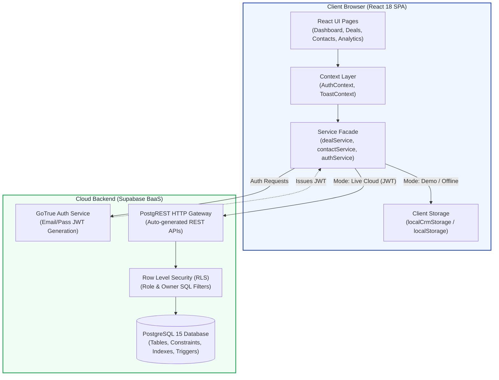
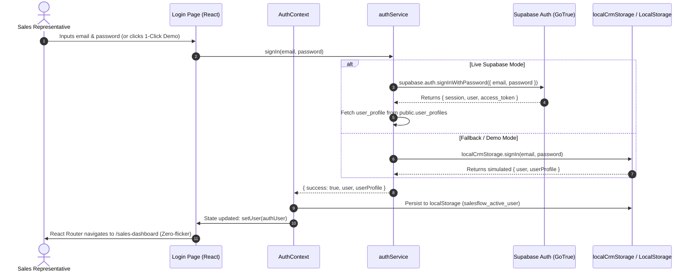
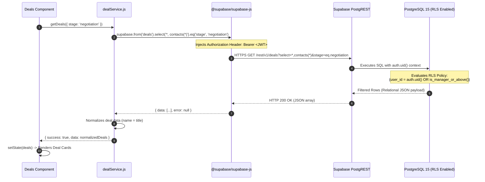
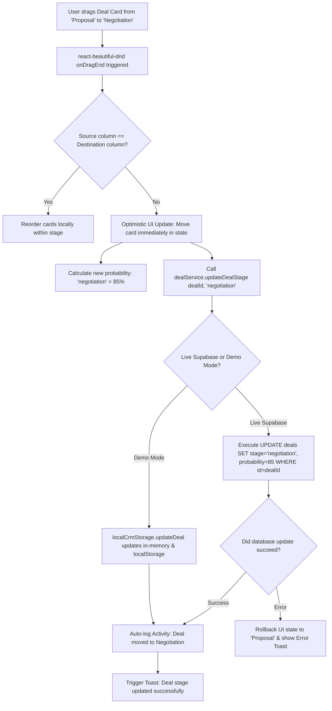
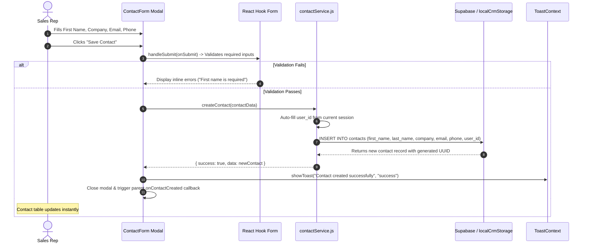

# SalesFlow Pro CRM — System Architecture & Workflows

> **Academic Project Documentation & Evaluation Dossier**  
> **Student Name:** Shubham  
> **Repository:** [https://github.com/Not-Shubham09/salesflow-pro](https://github.com/Not-Shubham09/salesflow-pro)

---

## 1. High-Level Architectural Overview

SalesFlow Pro follows a **Decoupled Client-BaaS (Backend-as-a-Service) Architecture** augmented with a **Local Storage Resilience Layer**.

```
+-----------------------------------------------------------------------------------------+
|                                    CLIENT BROWSER                                       |
|                                                                                         |
|   +-------------------+       +--------------------+       +------------------------+   |
|   |   Presentation    | <---> |   State & Context  | <---> |   Service Layer        |   |
|   |   (React Pages &  |       |   (AuthContext,    |       |   (dealService,        |   |
|   |    UI Components) |       |    ToastContext)   |       |    contactService)     |   |
|   +-------------------+       +--------------------+       +------------------------+   |
|                                                                    |          |         |
|                                                 +------------------+          |         |
|                                                 | (Online / Live)             | (Offline|
|                                                 v                             |  / Demo)|
+------------------------------------------+---------------+                    v         |
                                           | Supabase SDK  |            +---------------+ |
                                           +---------------+            | localCrm-     | |
                                                   |                    | Storage       | |
                                                   v                    +---------------+ |
                                          (HTTPS / WSS / JWT)                   |         |
                                                   |                            v         |
+--------------------------------------------------|-----------+         +---------------+ |
|                 CLOUD BACKEND                    |           |         | localStorage  | |
|                                                  v           |         | (Browser DB)  | |
|     +------------------------------------------------------+ |         +---------------+ |
|     |            Supabase Managed Services                 | |                           |
|     |  +---------------------+    +---------------------+  | |                           |
|     |  |  GoTrue Auth Engine |    |   PostgREST Engine  |  | |                           |
|     |  |  (JWT & Sessions)   |    |   (RESTful Endpts)  |  | |                           |
|     |  +---------------------+    +---------------------+  | |                           |
|     |                            |                         | |                           |
|     |                            v                         | |                           |
|     |  +------------------------------------------------+  | |                           |
|     |  |           PostgreSQL 15 Relational DB          |  | |                           |
|     |  |  (Tables, Enums, Foreign Keys, RLS, Triggers)  |  | |                           |
|     |  +------------------------------------------------+  | |                           |
|     +------------------------------------------------------+ |                           |
+--------------------------------------------------------------+---------------------------+
```

### The 4 Architectural Layers Explained Simply:
1. **Presentation Layer (React Views & Components):**
   - React components render the DOM declaratively based on application state.
   - User interactions (dragging a Kanban card, submitting a form, clicking a filter) trigger handlers that dispatch actions to services.
2. **State & Context Layer (`AuthContext`, `ToastContext`):**
   - Centralizes global state. Holds the currently authenticated user (`user`), their role profile (`userProfile`), active environment mode (`isDemoMode`), and toast alert dispatchers.
   - Eliminates "prop drilling" by making user information accessible to any component via `useAuth()`.
3. **Service Abstraction Layer (`*Service.js`):**
   - Encapsulates all data access logic.
   - Components never execute raw SQL or fetch calls directly. Instead, they call `dealService.getPipelineDeals()` or `contactService.createContact()`.
   - The service inspects `isDemoMode()`: if live, it executes a query via the Supabase client SDK; if demo or offline, it routes to `localCrmStorage`.
4. **Data & Security Layer (PostgreSQL & RLS):**
   - Stored in a hosted PostgreSQL 15 database.
   - Enforces relational constraints (e.g., deleting a contact cascades or sets null on linked deals).
   - Enforces Row Level Security (RLS) policies at the SQL engine level.

---

## 2. Core Architectural Diagrams

### Diagram 1: System Architecture Diagram



---

### Diagram 2: User Authentication Flow



---

### Diagram 3: Database Interaction & RLS Flow



---

### Diagram 4: Drag & Drop Kanban Pipeline Workflow



---

### Diagram 5: CRUD Operation Flow (Creating a Contact)



---

## 3. Step-by-Step Verbal Walkthrough for Professor

When your professor asks: *"Explain how your frontend connects to the database,"* explain it in these exact 4 steps:

> 1. **"The UI triggers a service method:** When a user interacts with a page—for example, clicking 'Create Deal'—the React component collects the form inputs and invokes our service layer, such as `dealService.createDeal(data)`."
> 2. **"The service attaches authentication:** The service automatically inspects the active session managed by `AuthContext`. It attaches the current user's authenticated ID and sends an HTTPS request to Supabase's PostgREST gateway with the user's JWT bearer token."
> 3. **"The database validates and filters with RLS:** When PostgreSQL receives the request, it doesn't just run raw SQL. It activates our **Row Level Security (RLS)** policies. If a regular sales rep is logged in, PostgreSQL verifies that `user_id = auth.uid()`. If a manager or director is logged in, the `is_manager_or_above()` SQL function allows them to see team-wide deals."
> 4. **"The React UI updates state:** PostgREST serializes the relational data directly into JSON. The service normalizes the field names and returns the result to the React component, which calls `setDeals()` to instantly re-render the view without reloading the page."
