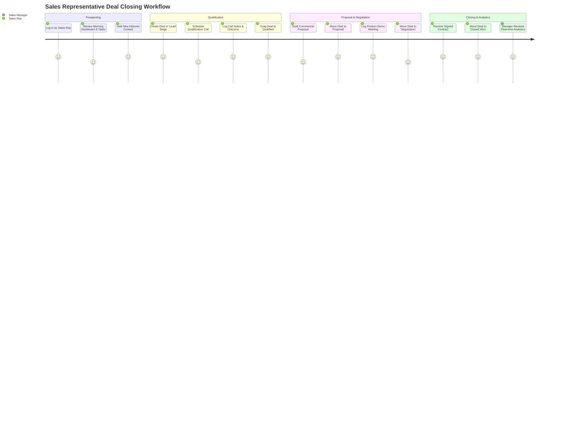

# SalesFlow Pro CRM — Comprehensive Project Overview

> **Academic Project Documentation & Evaluation Dossier**  
> **Student Name:** Shubham  
> **Course / Degree:** Bachelor of Technology / Computer Science & Engineering  
> **Repository:** [https://github.com/Not-Shubham09/salesflow-pro](https://github.com/Not-Shubham09/salesflow-pro)  
> **Application Title:** SalesFlow Pro — Enterprise-Grade Customer Relationship Management System  
> **Architecture:** Modern Single Page Application (React 18 + Vite) with BaaS Persistence (Supabase / PostgreSQL) & Local Storage Resilience

---

## 1. Executive Summary

**SalesFlow Pro** is a modern, responsive, full-stack Customer Relationship Management (CRM) web application engineered to streamline the end-to-end B2B sales lifecycle. Designed specifically for modern sales teams, the application unifies lead capture, visual pipeline progression via interactive drag-and-drop Kanban boards, contact lifecycle tracking, multi-channel customer activity logging, task delegation, and real-time revenue analytics into a cohesive, high-performance interface.

The application addresses critical pain points in modern sales operations: fragmented communication, inaccurate pipeline forecasting, manual data re-entry, and clumsy enterprise software that slows down sales representatives.

---

## 2. Problem Statement & Motivation

### The Industry Challenge
In small to mid-sized B2B enterprises, sales teams frequently struggle with:
1. **Pipeline Blindspots:** Deals stagnate across opaque stages without visibility into bottlenecks or time-in-stage metrics.
2. **Disconnected Customer Interactions:** Customer touchpoints (phone calls, emails, product demos) are recorded across disjointed spreadsheets, resulting in dropped follow-ups.
3. **Data Loss & Tool Friction:** Complex enterprise CRMs (like legacy Salesforce configurations) suffer from poor UX, slow page loads, and steep learning curves, causing reps to avoid updating CRM data.
4. **Cloud / Connectivity Fragility:** Web applications that rely solely on active internet connections crash or lock users out when network drops occur, interrupting field reps during critical customer meetings.

### The Proposed Solution
SalesFlow Pro was engineered from the ground up to provide:
- **Instant Visual Clarity:** An interactive 6-stage Kanban board (`Lead` → `Qualified` → `Proposal` → `Negotiation` → `Closed Won` → `Closed Lost`) with automatic win-probability calculation.
- **Unified 360° Customer Profiles:** Comprehensive contact dossiers linking company affiliations, direct communication history, and active opportunities.
- **Fail-Safe Dual-Engine Persistence:** A hybrid architectural pattern where the frontend connects directly to a live PostgreSQL backend via Supabase REST/PostgREST APIs while seamlessly maintaining an offline-ready in-browser persistence engine (`localCrmStorage`).
- **Frictionless SaaS Ergonomics:** A lightweight, sub-second interface built with React 18, Vite, and Tailwind CSS, following modern Stripe/Linear design principles.

---

## 3. Target Audience & Personas

SalesFlow Pro is architected with Role-Based Access Control (RBAC) supporting four distinct organizational personas:

| Persona / Role | Core Responsibilities | Primary Needs in SalesFlow Pro |
| :--- | :--- | :--- |
| **Sales Representative** (`sales_rep`) | Day-to-day prospecting, customer discovery, qualification calls, and moving assigned deals forward. | Fast deal creation, quick contact search, activity logging (calls/meetings), task reminders, and pipeline visibility. |
| **Sales Manager** (`sales_manager`) | Team coaching, pipeline hygiene review, deal unblocking, and quota pacing. | Overview of all team deals, stage velocity, aggregate pipeline value, and territory assignment. |
| **Sales Director** (`sales_director`) | Strategic revenue forecasting, resource allocation, and conversion funnel analysis. | Executive dashboard metrics, win/loss ratios, quarterly pipeline analytics, and team performance charts. |
| **System Administrator** (`admin`) | System configuration, user provisioning, role assignments, audit logs, and security compliance. | User management, security permissions, data import/export, and global system settings. |

---

## 4. Key Functional Modules

```
+-----------------------------------------------------------------------+
|                         SALESFLOW PRO CRM                             |
+-----------------------------------------------------------------------+
|  1. Authentication & RBAC Engine (Supabase Auth + Session Caching)    |
|  2. Executive Sales Dashboard (Revenue Forecast, Velocity, Metrics)   |
|  3. Visual Kanban Pipeline (6-Stage Drag & Drop with react-beautiful-dnd)
|  4. Deal Management Module (Full Lifecycle, Filtering, Modal Creation)|
|  5. Contact Dossier & CRM Directory (Tags, Profiles, History)        |
|  6. Chronological Activity Feed (Calls, Meetings, Emails, Notes)      |
|  7. Task Management & Follow-up Scheduling Engine                     |
|  8. Pipeline Analytics Engine (Recharts Funnel, Win/Loss, Trajectory) |
|  9. Administration & Settings (RBAC Matrix, Team Provisioning)        |
+-----------------------------------------------------------------------+
```

### Module Breakdown:
1. **Authentication & Session Management:**
   - Multi-role sign-in with email and password.
   - Synchronous session hydration from `localStorage` prevents unauthenticated screen flicker on page reload.
   - Built-in 1-click demo role switching (`Sales Manager`, `Sales Rep`, `Sales Director`, `System Admin`).
2. **Sales Dashboard & Kanban Board:**
   - Real-time pipeline calculation (Total Pipeline Value, Weighted Value, Win Rate, Active Deals).
   - Six horizontally scrollable 260px columns representing deal stages.
   - Drag-and-drop deal movement with dynamic stage and probability synchronization.
3. **Contact Management:**
   - Searchable and filterable customer directory.
   - Contact detail side-panels showing linked deals, contact status, notes, and tags.
   - CSV export and import capabilities.
4. **Deal Management:**
   - Detailed deal view with timeline of events, document attachments, and contact linkage.
   - Quick Deal creation modal accessible globally from the header and dashboard.
5. **Activity & Task Engine:**
   - Time-stamped activity logging (Email, Phone Call, Meeting, Demo, Internal Note).
   - Task completion toggling with priority-coded badges (`urgent`, `high`, `medium`, `low`).
6. **Pipeline Analytics:**
   - Interactive charts powered by Recharts: monthly pipeline value, stage conversion funnel, win-loss breakdown, and sales rep comparison.
7. **Administration & Settings:**
   - Team member management with role editing, custom fields builder, and email templates.

---

## 5. End-to-End User Journey



1. **Sign-In:** Sales representative logs into SalesFlow Pro using role-based credentials.
2. **Morning Standup / Dashboard Review:** The representative checks upcoming tasks (e.g., "Schedule technical demo for Globex") and reviews pipeline metrics.
3. **Contact Ingestion:** A new prospective buyer is added through the Contact Management module with company name, email, phone, and tags.
4. **Opportunity Creation:** A deal is created for \$75,000 linked directly to the contact and placed in the `Lead` stage.
5. **Stage Progression:** Following customer qualification, the deal card is dragged to `Qualified`. The win probability automatically updates from 20% to 40%.
6. **Interaction Logging:** Every touchpoint (call, email, demo) is logged into the Activity Timeline with duration and notes.
7. **Closing the Deal:** After negotiating commercial terms, the deal is dragged to `Closed Won` (100% probability).
8. **Executive Visibility:** The Sales Director opens the Analytics tab to observe the updated revenue forecast, conversion rate, and pipeline velocity in real time.

---

## 6. What Makes SalesFlow Pro Stand Out?

- **Zero-Flicker Architecture:** Custom session hydration guarantees zero unauthenticated flash or layout jumps upon browser reloads.
- **Fail-Safe Offline/Demo Mode:** When demonstrating the system in lecture halls or college viva rooms where network connectivity might drop, SalesFlow Pro's built-in `localCrmStorage` takes over transparently without throwing uncaught exceptions.
- **Ergonomic Design System:** Engineered with strict 74px header constraints, 260px Kanban columns, and standardized semantic color tokens (`primary`, `success`, `warning`, `error`).
- **Academic Rigor:** Built with production-grade database patterns including PostgreSQL Foreign Keys, Enums, Row Level Security (RLS) policies, and database triggers.
